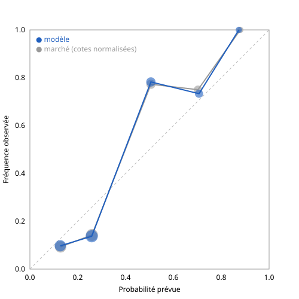

# Résultats

Généré le 25/11/2026 par `evaluer.py` sur 45 matchs joués.

| Série | Brier (↓) | RPS (↓) | Log-loss (↓) | Brier skill vs 1/3 |
|---|---|---|---|---|
| Modèle | 0.3977 | 0.1452 | 0.7091 | +40.3% |
| Marché | 0.3937 | 0.1436 | 0.7031 | +40.9% |
| Uniforme (1/3 partout) | 0.6667 | 0.2593 | 1.0986 | 0 |

**Modèle − marché (Brier)** : +0.0039, IC 95 % bootstrap [+0.0014 ; +0.0070].

**Modèle − marché (RPS)** : +0.0016, IC 95 % bootstrap [+0.0006 ; +0.0029].

Négatif = le modèle fait mieux que le marché. Si l'intervalle contient 0, la différence n'est pas significative.

## Choix principal

- Tous les matchs : 78% de bons choix (45 matchs)
- Matchs retenus (P ≥ 55 %) : 81% (26 matchs)

## Calibration

| Proba prévue (moy.) | Fréquence observée | N |
|---|---|---|
| 0.13 | 0.10 | 41 |
| 0.26 | 0.14 | 51 |
| 0.51 | 0.78 | 23 |
| 0.71 | 0.73 | 15 |
| 0.87 | 1.00 | 5 |

Avec 45 matchs (135 probabilités), la calibration reste très bruitée : à lire à partir de ~100 matchs.

## Marché seul, toutes journées

Les journées J2 et J3 n'ont pas été archivées avant les matchs. Leurs cotes de clôture ont été relevées après coup (`marche_cloture_J2-J3.csv`) : elles mesurent le marché, jamais le modèle, et n'entrent pas dans la comparaison ci-dessus.

- 81 matchs (45 de la J1 + 36 des J2-J3)
- Brier marché : 0.4453 (uniforme : 0.6667, skill +33.2%)
- Log-loss marché : 0.7823
- Favori du marché gagnant : 70%

| Proba marché (moy.) | Fréquence observée | N |
|---|---|---|
| 0.13 | 0.12 | 76 |
| 0.27 | 0.17 | 92 |
| 0.50 | 0.74 | 38 |
| 0.71 | 0.72 | 29 |
| 0.86 | 0.88 | 8 |
