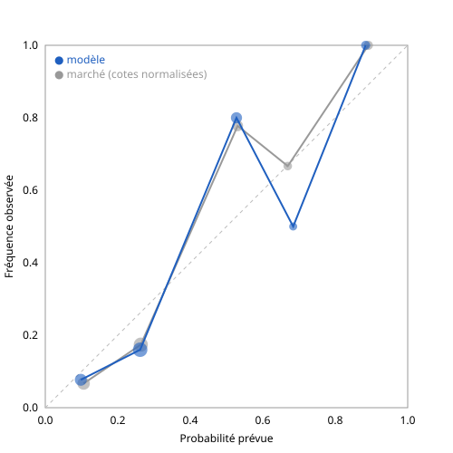

# Résultats

Généré le 28/10/2026 par `evaluer.py` sur 18 matchs joués.

| Série | Brier (↓) | Log-loss (↓) | Brier skill vs 1/3 |
|---|---|---|---|
| Modèle | 0.3658 | 0.6602 | +45.1% |
| Marché | 0.3560 | 0.6452 | +46.6% |
| Uniforme (1/3 partout) | 0.6667 | 1.0986 | 0 |

**Modèle − marché (Brier)** : +0.0099, IC 95 % bootstrap [+0.0041 ; +0.0162].
Négatif = le modèle fait mieux que le marché. Si l'intervalle contient 0, la différence n'est pas significative.

## Choix principal

- Tous les matchs : 78% de bons choix (18 matchs)
- Matchs retenus (P ≥ 55 %) : 89% (9 matchs)

## Calibration

| Proba prévue (moy.) | Fréquence observée | N |
|---|---|---|
| 0.10 | 0.08 | 13 |
| 0.26 | 0.16 | 25 |
| 0.53 | 0.80 | 10 |
| 0.68 | 0.50 | 2 |
| 0.88 | 1.00 | 4 |

Avec 18 matchs (54 probabilités), la calibration reste très bruitée : à lire à partir de ~100 matchs.

## Marché seul, toutes journées

Les journées J2 et J3 n'ont pas été archivées avant les matchs. Leurs cotes de clôture ont été relevées après coup (`marche_cloture_J2-J3.csv`) : elles mesurent le marché, jamais le modèle, et n'entrent pas dans la comparaison ci-dessus.

- 54 matchs (18 de la J1 + 36 des J2-J3)
- Brier marché : 0.4584 (uniforme : 0.6667, skill +31.2%)
- Log-loss marché : 0.8026
- Favori du marché gagnant : 67%

| Proba marché (moy.) | Fréquence observée | N |
|---|---|---|
| 0.13 | 0.12 | 48 |
| 0.27 | 0.20 | 66 |
| 0.51 | 0.72 | 25 |
| 0.70 | 0.69 | 16 |
| 0.86 | 0.86 | 7 |
