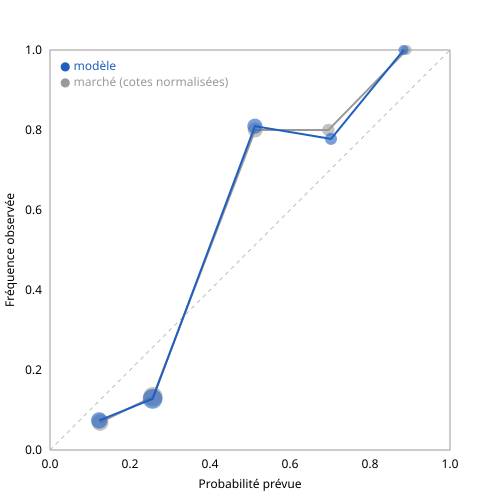

# Résultats

Généré le 04/11/2026 par `evaluer.py` sur 27 matchs joués.

| Série | Brier (↓) | Log-loss (↓) | Brier skill vs 1/3 |
|---|---|---|---|
| Modèle | 0.3803 | 0.6851 | +42.9% |
| Marché | 0.3738 | 0.6751 | +43.9% |
| Uniforme (1/3 partout) | 0.6667 | 1.0986 | 0 |

**Modèle − marché (Brier)** : +0.0066, IC 95 % bootstrap [+0.0024 ; +0.0113].
Négatif = le modèle fait mieux que le marché. Si l'intervalle contient 0, la différence n'est pas significative.

## Choix principal

- Tous les matchs : 81% de bons choix (27 matchs)
- Matchs retenus (P ≥ 55 %) : 85% (13 matchs)

## Calibration

| Proba prévue (moy.) | Fréquence observée | N |
|---|---|---|
| 0.11 | 0.06 | 17 |
| 0.26 | 0.13 | 39 |
| 0.51 | 0.82 | 17 |
| 0.70 | 0.75 | 4 |
| 0.88 | 1.00 | 4 |

Avec 27 matchs (81 probabilités), la calibration reste très bruitée : à lire à partir de ~100 matchs.

## Marché seul, toutes journées

Les journées J2 et J3 n'ont pas été archivées avant les matchs. Leurs cotes de clôture ont été relevées après coup (`marche_cloture_J2-J3.csv`) : elles mesurent le marché, jamais le modèle, et n'entrent pas dans la comparaison ci-dessus.

- 63 matchs (27 de la J1 + 36 des J2-J3)
- Brier marché : 0.4514 (uniforme : 0.6667, skill +32.3%)
- Log-loss marché : 0.7930
- Favori du marché gagnant : 70%

| Proba marché (moy.) | Fréquence observée | N |
|---|---|---|
| 0.13 | 0.12 | 52 |
| 0.27 | 0.17 | 80 |
| 0.50 | 0.75 | 32 |
| 0.71 | 0.72 | 18 |
| 0.86 | 0.86 | 7 |
